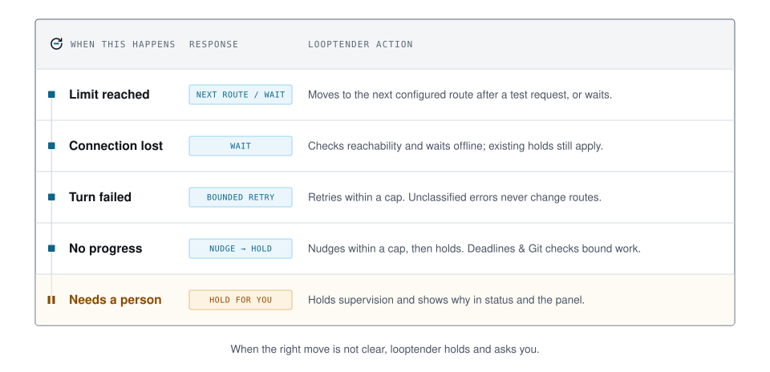

<picture>
  <source media="(prefers-color-scheme: dark)" srcset="docs/assets/looptender-banner-hub-dark.svg">
  <source media="(prefers-color-scheme: light)" srcset="docs/assets/looptender-banner-hub-light.svg">
  
</picture>

# looptender

looptender supervises a coding agent: it wakes an idle session, handles structured failures with bounded retries, and can hand off to a confirmed fallback when configured. Your agents do the work. looptender keeps their loops supervised, bounded, and visible.

<picture>
  <source media="(prefers-color-scheme: dark)" srcset="docs/assets/looptender-model-dark.svg">
  <source media="(prefers-color-scheme: light)" srcset="docs/assets/looptender-model-light.svg">
  
</picture>

In one line: you talk to one coordinator per project. The coordinator splits the work into lanes, picks a model for each lane that fits its task, and sends requests to the coordinators of your other projects, which can decline them. looptender keeps each coordinator going while you are away, and stops to ask you when something needs your approval.

The picture has three parts, using the words in the [glossary](docs/glossary.md):

- **You** are the person in the loop. Goals and approvals come from you, and a **hold** sends nothing until a person acts.
- A **coordinator** is the session you put under supervision: it hands out work and reviews it. Supervising that one session is a **loop**. looptender wakes it, keeps it within the limits you set, recovers it from structured failures and holds it for you when it needs a person. Coordinator is a role, not a setting: a session that delegates nothing is supervised the same way.
- **Lanes** are the conversations a coordinator starts for pieces of its work, each on the model the coordinator chose for it. For a BB loop looptender counts them and their state, so a working lane keeps the loop from being woken as idle; it retries a lane's failed turn when the loop opts in, and stops lanes when a person asks with `stop --lanes`.

looptender is a single binary for macOS, Linux and Windows. Its daemon, a managed service or an existing scheduler runs the checks; the computer and the supervisor must be running for them to happen. Today supervision runs [on the same machine as the agents](docs/architecture.md); [loops across devices](docs/roadmap.md#loops-across-devices-planned) are planned.

## What it handles

These are the failures that stop an agent nobody is watching, and what looptender does about each today:

<picture>
  <source media="(prefers-color-scheme: dark)" srcset="docs/assets/looptender-failures-dark.svg">
  <source media="(prefers-color-scheme: light)" srcset="docs/assets/looptender-failures-light.svg">
  
</picture>

- **A provider limit is reached.** looptender moves to the next route you configured, in your order (an ordered list, not a pool it balances), after one small real request confirms it works; without one it waits for the reset. Returning to the first route is opt-in, and [preferred routes](docs/roadmap.md#preferred-routes-planned) are partly implemented. [Routes](docs/fallbacks.md).
- **The network drops.** Re-prompts, handoffs and probes wait for a later check that finds the network up. One real outage was observed; unattended lane recovery and the full network-cut procedure remain unverified ([evidence](docs/testing.md#observed-once-a-real-outage-2026-11-14)).
- **The machine sleeps or restarts.** Nothing runs while it is off. A [service](docs/services.md) or scheduler can run checks again afterwards, though that return is not yet verified live; `status` and the panel show what was recorded.
- **A turn fails.** A failed BB turn is retried by reference; an unclassified error gets a capped number of re-prompts, then a hold, and never moves the work to another route.
- **No progress.** Nudges are capped, then the loop holds; optional deadlines, send limits and a Git no-progress timeout bound the total.

Whenever the right move is not clear, looptender holds and asks you instead of deciding for you.

## How this differs from built-in loops

Agent tools have their own loops, retries and background agents, and each of them knows only its own tool. looptender runs on your machine outside any one tool and watches sessions in several of them. You do not do your development through it, and it is not another chat interface: each session stays where it lives, and looptender only watches, wakes, bounds and holds it.

<picture>
  <source media="(prefers-color-scheme: dark)" srcset="docs/assets/looptender-tools-dark.svg">
  <source media="(prefers-color-scheme: light)" srcset="docs/assets/looptender-tools-light.svg">
  
</picture>

## Works with

| Tool | Status |
| --- | --- |
| BB threads, with lanes and the BB plugin | released (v0.2.0) |
| Headless Claude Code and Codex | released (v0.2.0) |
| Cursor CLI, as the first route only | released (v0.2.0) |
| An agent defined in configuration, or any program with status and resume commands | released (v0.2.0); definitions tested with stand-ins only |
| The panel: one local page for every loop | released (v0.2.0) |
| Antigravity CLI, as the first route only | in source |
| Observing a sessionpipe session; Telegram, Slack, Discord, ntfy and Pushover alerts | in source |
| macOS menu | in source (developer build) |
| Loops across devices; waking an observed sessionpipe session | planned |

What has been verified for each, and what is still open, is in [availability](docs/availability.md).

## Install

```sh
brew install looptender/tap/looptender
looptender version
```

Or build from source with Go 1.24 or newer:

```sh
go install github.com/looptender/looptender/cmd/looptender@main
```

That installs unreleased source as `looptender`. The v0.2.0 release archives, and the pinned v0.2.0 `go install` path, carry the executable under its earlier name; see [installing looptender](docs/install.md) for those, development builds and the BB plugin.

## Quick start

Sign in to a supported agent CLI first, or use an existing BB thread. From a Git project with at least one commit:

```sh
looptender init
```

1. Choose a task, an agent and operating limits. The default is one agent with no fallbacks.
2. Review the plan. Creation writes a **disabled** private setup outside the checkout; it runs no agent, probe, login or scheduler.
3. Run the `doctor` command setup prints, and read its warnings.
4. Run the printed `start --foreground` command to enable and supervise the loop, or `--background` to detach. Background mode installs no service.

Then, with the configuration path setup printed (this one is fictional):

```sh
looptender status -c /private/example-loop/looptender.yaml
looptender pause -c /private/example-loop/looptender.yaml --note "reviewing by hand"
looptender resume -c /private/example-loop/looptender.yaml
looptender stop -c /private/example-loop/looptender.yaml
looptender complete -c /private/example-loop/looptender.yaml --note "Task verified"
```

`stop` stops the supervised conversation at the next check (`--lanes` also stops the conversations it started); `complete` records a declaration, not a verification; `resume` clears the holds a person or looptender set. The [setup guide](docs/setup.md) covers scripted setup, accounts, limits and Windows; [operations](docs/operations.md) covers every control.

## Learn more

- [A tour of looptender](docs/overview.md): models and accounts, fallbacks, the prompt, the panel, alerts, what it does and its limits.
- [Availability](docs/availability.md): what is released, in source and verified.
- [Setup](docs/setup.md), [configuration](docs/configuration.md), [operations](docs/operations.md), [diagnostics](docs/diagnostics.md) and [services](docs/services.md).
- [Fallbacks](docs/fallbacks.md), [accounts](docs/accounts.md), [the standard route list](docs/routes.md) and [the panel](docs/dock.md).
- [Coordinating lanes](docs/coordinating-lanes.md), [goals](docs/goals.md), [transfer](docs/transfer.md) and [the BB plugin](docs/install.md#the-bb-plugin).
- [Architecture](docs/architecture.md), [glossary](docs/glossary.md), [roadmap](docs/roadmap.md), [testing](docs/testing.md), [release verification](docs/release-verification.md) and the [changelog](CHANGELOG.md).

## Contributing

See [CONTRIBUTING.md](CONTRIBUTING.md) for commit sign-offs and the short [contributor agreement](CONTRIBUTOR_LICENSE_AGREEMENT.md). Use fictional data everywhere, and keep documentation clear about what is implemented, released and verified ([capability and documentation review](docs/testing.md#capability-and-documentation-review)).

## License

looptender is **source-available** under the [Sustainable Use License 1.0](LICENSE).

- Personal use and ordinary internal company use are free, including supervising your company's own agents and using your own installation in consulting or client work.
- You can inspect and modify the source, and share copies free of charge for noncommercial purposes while preserving the required notices.
- Selling looptender, incorporating its implementation into a commercial product such as an IDE, agent host or managed service, or offering it as a paid hosted service requires a separate commercial agreement.

An agent or tool that makes itself supervisable, or that calls a permitted looptender installation through its command line and JSON output, does not by itself require a commercial agreement. This is not an OSI-approved open-source license. See the [licensing guide](LICENSING.md) for examples and commercial inquiries; the license text governs.
