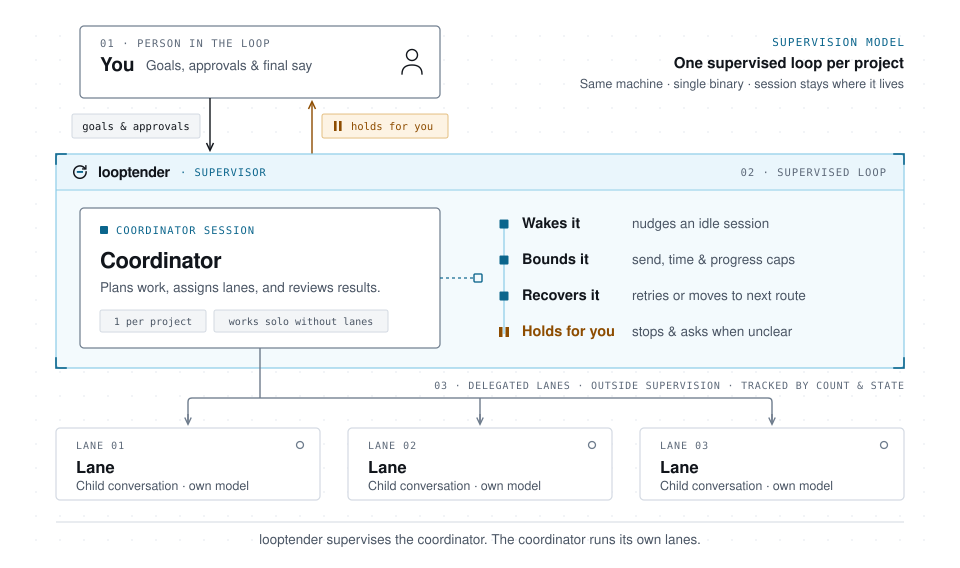
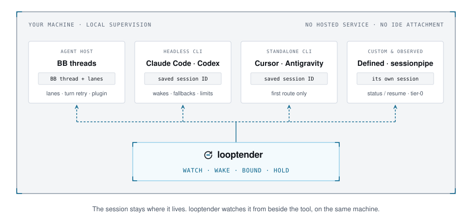

<picture>
  <source media="(prefers-color-scheme: dark)" srcset="docs/assets/looptender-hero-dark.webp">
  <source media="(prefers-color-scheme: light)" srcset="docs/assets/looptender-hero-light.webp">
  
</picture>

# looptender

**Looptender is the operations layer for agent work and automations.**

Its product direction is to coordinate what runs next, when and where it runs, and which configured resources it uses, while keeping progress, problems and decisions visible. Today, local supervision is the delivered foundation: waking idle sessions, handling structured failures with bounded retries, and handing off to a configured fallback after a small test request. Unified management of external schedules, opt-in Looptender-owned scheduling and allowance-aware work pooling are planned. The agent does the repository work; looptender never edits, commits to or merges a repository.

Latest release: **v0.3.0** (26 November 2026; [release notes](docs/releases/v0.3.0.md)). Every capability below is labelled **Released in v0.3.0**, **Released in v0.2.0**, **In source, not yet released**, or **Planned**.

## How it works

*Released in v0.2.0*

You talk to one coordinator per project. The coordinator splits work into lanes and reviews results. looptender is the supervisor around the coordinator: it wakes it, keeps it within limits you set, recovers it from structured failures, and holds it for you when a person is needed.

<picture>
  <source media="(prefers-color-scheme: dark)" srcset="docs/assets/looptender-model-dark.svg">
  <source media="(prefers-color-scheme: light)" srcset="docs/assets/looptender-model-light.svg">
  
</picture>

Using the words in the [glossary](docs/glossary.md):

- **You** — Goals and approvals come from you. A **hold** sends nothing until a person acts.
- **Coordinator (a loop)** — The session you put under supervision. A session that delegates nothing is supervised the same way.
- **Lanes** — Child conversations a coordinator starts for parallel work, each on the model the coordinator chose for it. For a BB loop, looptender tracks their count and state so working lanes keep an idle coordinator from being woken, retries a failed lane only when opted in, and stops lanes only when a person asks (`stop --lanes`).

Supervision runs on the same machine as the agents from a single binary (macOS, Linux and Windows), using its daemon, a managed [service](docs/services.md) or an existing scheduler. The computer and the supervisor must be running for checks to happen; each session stays where it lives. See [architecture](docs/architecture.md) for boundaries and [loops across devices](docs/roadmap.md#loops-across-devices-planned) for planned multi-device work.

## What it handles today

*Released in v0.2.0*

<picture>
  <source media="(prefers-color-scheme: dark)" srcset="docs/assets/looptender-failures-dark.svg">
  <source media="(prefers-color-scheme: light)" srcset="docs/assets/looptender-failures-light.svg">
  
</picture>

- **Limit reached.** Waits for a reported reset, or moves to the next route in your ordered list after one small real request confirms that route works. Routes are an ordered list, not a balanced pool; returning to the first route is opt-in, and [preferred routes](docs/roadmap.md#preferred-routes-planned) are partly implemented. [Routes](docs/fallbacks.md).
- **Connection lost.** Checks configured reachability before recovery work and waits for a later check while the network is down, sending nothing. One real outage was observed; unattended lane recovery and the full network-cut procedure remain unverified ([evidence](docs/testing.md#observed-once-a-real-outage-2026-11-14)).
- **The machine sleeps or restarts.** Nothing runs while it is off. A [service](docs/services.md) or scheduler can run checks again afterwards, though that return is not yet verified live; `status` and the panel show what was recorded.
- **A turn fails.** Retries or re-prompts within a cap (a failed BB turn is retried by reference). An error looptender cannot classify from structured signals stays `unknown` and never moves the work to another route.
- **No progress.** Nudges a stalled session within a cap, then holds for a person. Optional deadlines, send limits and a Git-based no-progress timeout bound total work.
- **Needs a person.** Holds supervision and shows it in `status` and the panel until a person acts.

**When the right move is not clear, looptender holds and asks you.**

The panel's [Usage page](docs/dock.md#what-the-page-shows) and
[status diagnostics](docs/operations.md#savings-figures) distinguish withheld-check
counts from current context occupancy. These records do not measure subscription
savings; cache reuse and provider accounting remain unknown. An unreleased
[explicit compact workflow](integrations/bb-plugin-keepgoing/skills/keepgoing/references/compaction-workflow.md)
supplies opt-in grants, durable attempts and continuity reconciliation; it is
never invoked by the supervisor and adds no automatic context policy.

**Usage conservation — Planned, high priority.** Keep useful work moving while
reducing avoidable subscription usage. The [roadmap](docs/roadmap.md#high-priority-conserve-subscription-usage)
covers measured usage by loop, lane and provider, cache-aware diagnostics,
redundant wakes/retries and duplicate work, lane overhead, safe context lifecycle,
and explicit user-selected model/effort policies. Each improvement must preserve
useful throughput and quality. Integrated continuous optimization is planned;
current diagnostics and the unreleased manual helper do not establish subscription
savings or authorize silent model downgrades.

**Consumer ranking — In source, not yet released.** `looptender usage-rank --evidence FILE`
(or `--collection-dir DIR`) projects explicitly supplied local records as JSON.
It ranks recorded token components only among matching provider and declared/observed
periods with complete metric coverage. Partial counts remain visible and unranked;
account/model attribution and subscription savings remain unavailable. See the
[ranking contract](docs/design/usage-measurement.md#read-only-consumer-ranking-unreleased).

**Usage evidence — In source, not yet released.** The Panel can read a bounded
local [measurement export](docs/design/usage-measurement.md) to show provider token
trends, observed duplicate actions suppressed, and controlled-pair estimates per
accepted work unit. Missing data stays unavailable. Opt-in `loop.usage_collection: true` adds bounded
BB Codex metadata collection after existing primary-thread checks, with durable
cursors and Panel freshness/coverage. It requires the matching BB plugin source;
no new service or model request is added. Installed acceptance and
subscription-quota savings remain unverified; estimates disclose their baseline,
coverage and author-attested quality/cache conditions. The file reader currently
supports macOS/Linux; other platforms show evidence unavailable.

## When a usage limit hits: takeover

- **Handoff into a new conversation** (*Released in v0.2.0*): For a BB loop, an opt-in fallback (`bb.new_thread`) can start a new conversation on another configured provider when a usage limit hits and move supervision to that conversation. Creation is opt-in per loop, capped per loop and spaced at least an hour apart, and covered by offline fixtures only. Unreleased source also carries a useful source thread title into the successor at creation; see [naming scope and limits](docs/operations.md#bb-successor-thread-titles-unreleased).
- **Ownership, child lanes and setup default** (*Released in v0.3.0*): The new conversation also takes over loop ownership, takes the old conversation's direct child lanes, and starts successor lanes for lanes blocked by the limit. The setup panel offers opt-in takeover when BB reports another usable provider, and quota `switch_at` thresholds can trigger fallback checks before exhaustion.

Takeover moves supervision to a new conversation; it does not mean work is never lost or duplicated. The previous conversation is left untouched and may still be retried by BB after its limit resets.

## What you see

- **The panel** (*Released in v0.3.0*): One local page for every registered loop, served on `127.0.0.1` only with a per-run token and session cookie. Reviewed **Pause**, **Stop**, and **Resume** are enabled by default (`--read-only` disables all controls; `--allow-changes` adds routes, accounts, quotas, send-allowance editing, and binary adoption). Tested with offline fixtures and `jsdom`. [Panel](docs/dock.md).
  Unreleased source also exposes reviewed per-loop list edits, bounded catalog-selected headless additions, and an explicit copy of standard routes through the panel API; [scope and remaining interface work](docs/routes.md#per-loop-panel-api-unreleased).
  Draft [panel layout #587](docs/dock.md#landing-view-and-evidence-limits) puts Setup map above categorized attention and adds Accounts summary/filter/density views. It is unreleased presentation work; external BB question resolution, deadline editing and scheduler recovery remain backend gaps, with no installed rollout implied.
- **Plugin card** (*Plugin v0.4.0 released in v0.3.0*): BB plugin v0.4.0 ships from the v0.3.0 tag as a separate installation, adding the compact **Add to Looptender** modal, **Continue existing**, reboot-persistent service startup, single-line composer chips, weekly-limit status, build freshness lines, and sessionpipe visibility.
- **macOS menu-bar accessory** (*In source, not yet released as a separate app archive*): Developer build only; not included in CLI release archives. There is no Dock settings window or native HOME window yet. Grouped loop list, **Archive**, sessionpipe & quota summaries, panel opener, notifications, and build self-update checks. Unreleased loop ordering uses saved meaningful activity within the existing status groups, with no new date labels; [ordering semantics](integrations/macos/README.md). Unreleased automatic BB display names follow the latest saved title for the current target; [custom names remain pinned](docs/operations.md#one-name-per-line-of-work).
- **Accounts, Routes and Account Router** (*Released in v0.3.0*): Lists explicitly named accounts, local file login hints (plus bounded `--allow-changes` status checks and selection recovery), subscription quotas, guided route configuration, and a read-only **Account Router** overview card for `looptender router`. [Accounts](docs/accounts.md).
  Unreleased Accounts refinements add advancing reading ages and reset countdowns, remaining quota, and explicit ended/unavailable states; a passed reset requires a new reading to confirm capacity. Explicit per-selection automatic model-free reads share the panel/menu cache with bounded cadence and backoff; the updated menu or a non-offline panel/dock process must remain running. See [automatic usage](docs/accounts.md#automatic-selected-context-usage-unreleased).

## Next owner priorities

*Planned; the existing source features above remain separate.*

- **A native macOS HOME:** a useful overview graph of loops, their recorded lanes, accounts and configured fallback relations, alongside a separate configurable Accounts list. The graph must distinguish observed work, configured relationships and unverified account assignments. Windows/Linux desktop equivalents are deferred; the portable CLI, core and browser panel remain supported work.
- **Allowance-aware orchestration:** build real account pooling, preferred-route selection and lane distribution from explicit memberships and fresh structured allowance evidence. Today's catalog, ordered routes and automatic usage polling do not implement a pool; BB cannot select an account per thread. The first pooling slice is a pure Codex-evidence preview with explicit account/allowance IDs and complete occupancy, without a reader, CLI or dispatch; reservations and adapter binding remain future work.
- **Shared work intensity:** Low, Medium, High and Unleashed are planned configurable profiles with independent scope, holds, spend, reserve, effort and concurrency bounds. They require a preview and stale-data policy; no label grants unlimited work, clears a hold or changes existing permissions.
- **Find inefficiencies:** identify idle eligible capacity alongside authorized backlog, stranded or duplicate work, repeated/status-only wakes, rework, review/CI waits and stale polling from scoped structured evidence. Distinguish observations from suspected causes and measure overhead; recommend improvements in useful outcomes rather than maximizing tokens or utilization. Detection grants no adjustment authority. The [first read-only slice](docs/design/orchestration-policy.md#next-independent-implementation-slice-read-only-efficiency-findings) reuses existing records; it does not add an automatic dispatcher or replace the account/assignment stores.
- **Configurable work sources:** planned repo-docs default with optional issue/project/structured/ledger adapters later. The coordinator interprets prose; supervision checks explicit item/revision/authority bindings. Unreleased source adds an explicit [Markdown work register](docs/project-work.md) around the [read-only coverage projection](docs/design/orchestration-policy.md#first-coverage-slice-read-only-bound-inventory). Only its strict structured block is interpreted; source discovery, arbitrary prose interpretation and automatic task admission remain unimplemented.
- **Unified automation management and scheduling:** plan one view of schedules, run history, enabled state, dependencies/concurrency, outcomes and scoped controls across configured tools. Looptender will manage supported external schedules and offer opt-in owned schedules for explicitly new/adopted jobs, with one execution owner per job. Calendar/interval triggers, bounded missed-run policies and restart reconciliation belong to the planned contract. This is a [planned design track](docs/design/orchestration-policy.md#unified-automation-management-and-scheduling-planned), not implemented job management or permission to enable/move existing jobs.
- **Useful-work continuation:** a coordinator should revisit the authorized backlog when its current assignments settle, continue independent offline work while a particular action awaits approval, and report the remaining gaps. Active lanes and finished assignments alone do not prove useful delivery or exhaust the roadmap.

See the [orchestration policy and acceptance plan](docs/design/orchestration-policy.md) and [roadmap priorities](docs/roadmap.md#owner-priorities-and-implementation-boundaries). These are design requirements, not installed controls, automatic task selection or new conversation-creation authority.

## Keeps running while you update

*Released in v0.3.0*

- **In-place build adoption:** On macOS and Linux, a running daemon whose start path now points to a newly installed build checks file ownership, permissions, handover support, state format and configuration validation, then replaces itself in place (`daemon-shutdown`). State, holds, owner and send counts stay untouched, and a build that fails any check is refused while the daemon carries on. Windows daemons keep their build.
- **Low-disk notices and whole-line writes:** Warns when the state volume falls below the larger of 1 GiB or 2% free space and reports an error below 100 MiB, sending one notice per episode with a recovery margin so free space hovering at a threshold does not repeat alerts. Append logs take a lock and write whole lines only, saved session records are replaced whole, and build adoption waits while the volume is nearly full.

## What it never does

*Released in v0.2.0*

- Edit, commit to or merge a repository.
- Read your conversation to make a decision.
- Log in, create accounts or copy credentials during supervision.
- Call a model through a connection of its own.

looptender runs your installed agent tool with the logins and permissions you already set up, including when it sends one small test request before a handoff.

**Stop and pause always win.** Once configuration is verified, a stop is handled before anything else on every check, even while a loop is paused, disabled, completed or awaiting a person.

## How this differs from built-in loops

Agent tools have their own loops, retries and background agents, and each knows only its own tool. looptender runs on your machine outside any one tool and watches sessions in several of them. You do not do your development through it, and it is not another chat interface: each session stays where it lives, and looptender only watches, wakes, bounds and holds it.

<picture>
  <source media="(prefers-color-scheme: dark)" srcset="docs/assets/looptender-tools-dark.svg">
  <source media="(prefers-color-scheme: light)" srcset="docs/assets/looptender-tools-light.svg">
  
</picture>

## Works with

Supervision runs on the same machine as the agent tool. None of these adapters attach to a chat already open in an IDE window.

| Tool | Status | How it runs |
| --- | --- | --- |
| **BB threads** | Released in v0.2.0 | Existing thread you pick; lane awareness, retrying a failed turn by reference, and the separate BB plugin. |
| **Claude Code** | Released in v0.2.0 | Headless sessions started and resumed by exact session ID, with wakes, bounded re-prompts, fallbacks, limits and reports (no lane support). |
| **Codex** | Released in v0.2.0 | Headless sessions started and resumed by exact session ID, with wakes, bounded re-prompts, fallbacks, limits and reports (no lane support). |
| **Cursor CLI** | Released in v0.2.0 | Primary-only standalone runner with exact session resume; failures stay unclassified and it cannot be a fallback. |
| **Antigravity CLI** | Released in v0.3.0 | Primary-only ACP adapter with exact session resume and model-free `/usage` quota reads; cannot be a fallback. [Details](docs/antigravity.md). |
| **sessionpipe** | Released in v0.3.0 (nudges, re-prompts, stop & takeover: Planned) | Reports tier-0 loop state to a configured receiver; observes a tier-0 session file without sending by default, with separate explicit idle waking (`wake_only`), surfaced in the panel, macOS menu and BB plugin. Unreleased input validation rejects malformed sequences; current receiver/GUI/phone acceptance remains open. [Details](docs/sessionpipe.md). |
| **Agents defined in configuration** | Released in v0.2.0 | Describe another command-line agent (`adapter: custom`) by its status and resume commands; tested with stand-ins only. |
| **Remote alerts** | Released in v0.3.0 (`TG5` chat steering: Planned) | Telegram bot pairing/topics/reviewed controls (`TG1`–`TG4`), plus Slack, Discord, ntfy and Pushover presets; local fixtures only. [Telegram](docs/telegram.md). |
| **Loops across devices** | Planned | Cross-device fleet coordination and remote panel access; design-only and not built. [Roadmap](docs/roadmap.md). |

What has been verified for each, and what is still open, is in [availability](docs/availability.md).

## Install

*Released in v0.3.0*

The latest release is **v0.3.0** (26 November 2026; [release notes](docs/releases/v0.3.0.md)). Install with Homebrew:

```sh
brew install looptender/tap/looptender
looptender version
```

macOS on Apple silicon is the verified installation path; Intel macOS and Linux installations remain unverified. For other platforms, download archives and SHA-256 checksums from the [v0.3.0 release page](https://github.com/looptender/looptender/releases/tag/v0.3.0). Installing a release does not install the BB plugin or the macOS menu, and does not upgrade an already running supervisor.

Or build from source with Go 1.24 or newer:

```sh
go install github.com/looptender/looptender/cmd/looptender@main
```

That installs source from `main` as `looptender`. Release archives up through `v0.2.0` carried the binary under its earlier name alongside symlink aliases; see [installing looptender](docs/install.md) for development builds and the BB plugin.

## Quick start

Sign in to a supported agent CLI first, or use an existing BB thread. From a Git project with at least one commit:

```sh
looptender init
```

1. Choose a task, an agent and operating limits. The default is one agent with no fallbacks.
2. Review the plan. Creation writes a **disabled** private setup outside the checkout; it runs no agent, probe, login or scheduler.
3. Run the `doctor` command setup prints, and read its warnings.
4. Run the printed `start --foreground` command to enable and supervise the loop, or `--background` to detach. Background mode installs no service.

Then, with the configuration path setup printed (this one is fictional):

```sh
looptender status -c /private/example-loop/looptender.yaml
looptender pause -c /private/example-loop/looptender.yaml --note "reviewing by hand"
looptender resume -c /private/example-loop/looptender.yaml
looptender stop -c /private/example-loop/looptender.yaml
looptender complete -c /private/example-loop/looptender.yaml --note "Task verified"
```

`stop` stops the supervised conversation at the next check (`--lanes` also stops the conversations it started); `complete` records a declaration, not a verification (unreleased source [binds it to the current goal revision](docs/goals.md#completion-declarations-unreleased)); `resume` clears the holds a person or looptender set. Unreleased source refuses Resume when the configured deadline is already reached, with an instruction to review `loop.limits.deadline`; it never extends or removes that deadline. Unreleased BB diagnostics label completion as a declaration for that loop, not verification of current project or thread work; new messages do not clear its hold. Enabled registrations still block duplicate attachment while held or archived. Disk warnings show their own severity and measurement evidence; see [diagnostics](docs/operations.md#bb-loop-and-disk-diagnostics-unreleased). The [setup guide](docs/setup.md) covers scripted setup, accounts, limits and Windows; [operations](docs/operations.md) covers every control.

Unreleased source includes an explicit [Markdown project work register and reconciliation command](docs/project-work.md). A coordinator keeps stable work IDs, owners, acceptance and concrete waits in private `WORK.md`, then runs `init`, `read`, `check` or `checkpoint`. Local findings remain useful without runtime captures; supplied captures reuse the existing coverage/assignment bindings. Generated handoffs preserve full private text and prior snapshots. Local work has no item-count ceiling within the documented byte bound; an unsupported runtime coverage bridge stays explicitly unavailable without omitting work. The guide includes one-time recovery from available context and handoffs. This agent-operated helper adds no automatic turn-end hook, dispatch, runtime hold clearing or completion proof. A disconnected [observation controller](docs/project-work.md#continuity-observation-foundation) tests stale-result and timeout handling; automatic host checks and session wiring remain unimplemented.

Unreleased wake guidance instructs coordinators to inventory the whole authorized backlog before `await-user`, keeping approval-dependent actions held while independent work proceeds under existing controls. The owner thread may [withdraw only its own unchanged obsolete question](docs/operations.md#withdrawing-the-sessions-own-question) with `await-user --withdraw --note`; underlying or changed holds remain protected. This is not general resume or completion renewal. [Prompt adoption and remaining runtime gaps](docs/coordinating-lanes.md#use-lanes-to-advance-independent-work) are separate from source guidance.

Unreleased source includes a read-only [`pr-ready` helper](docs/pr-ready.md) beside `ci-wait`. It prints a commit to pin only for its conservative supported evidence subset; queue policy and head-only CI evidence remain unsupported.

### Withdraw only a reviewed completion

Unreleased Darwin/Linux source adds an external person-operated
[`client prepare-completion-renewal` / `client apply-completion-renewal`](docs/operations.md#completion-only-renewal)
pair. It withdraws one pinned completion while retaining historical notes,
questions and completion evidence, including legacy records without a goal.
It refuses other active holds and stale evidence. Ordinary later checks may
wake the existing target; this is neither acceptance nor a general resume.
No installed-loop, Windows execution or power-loss durability is claimed.

## Where it stands

- **Latest release:** v0.3.0 (26 November 2026; [notes](docs/releases/v0.3.0.md), folding the earlier unpublished v0.2.1 preparation).
- **Verification evidence:** Most recovery, router, Telegram, fallback, and panel behaviours are tested offline against fixtures and stand-in agents. The full live walkthrough (setup through multiple turns, hold, restart, recovery and completion) remains unfinished.
- **Observed network outage:** One unplanned real outage was observed on 14 November 2026 on one machine (down 1h 21m 57s): four checks waited and sent nothing, and the first check after recovery sent one re-prompt. Lane recovery and the full network-cut procedure remain unverified.
- **Cross-device fleet and remote access:** Planned, not built. Today supervision and the panel run only on the machine where the agents live.

## Learn more

- [A tour of looptender](docs/overview.md): models and accounts, fallbacks, the prompt, the panel, alerts, what it does and its limits.
- [Availability](docs/availability.md): what is released, in source and verified.
- [Setup](docs/setup.md), [configuration](docs/configuration.md), [operations](docs/operations.md), [diagnostics](docs/diagnostics.md) and [services](docs/services.md).
- [Fallbacks](docs/fallbacks.md), [accounts](docs/accounts.md), [the standard route list](docs/routes.md) and [the panel](docs/dock.md).
- [Coordinating lanes](docs/coordinating-lanes.md), [goals](docs/goals.md), [transfer](docs/transfer.md) and [the BB plugin](docs/install.md#the-bb-plugin).
- [Architecture](docs/architecture.md), [glossary](docs/glossary.md), [roadmap](docs/roadmap.md), [testing](docs/testing.md), [release verification](docs/release-verification.md) and the [changelog](CHANGELOG.md).

## Contributing

See [CONTRIBUTING.md](CONTRIBUTING.md) for commit sign-offs and the short [contributor agreement](CONTRIBUTOR_LICENSE_AGREEMENT.md). Use fictional data everywhere, and keep documentation clear about what is implemented, released and verified ([capability and documentation review](docs/testing.md#capability-and-documentation-review)).

## License

looptender is **source-available** (not OSI-approved open source) under the [Sustainable Use License 1.0](LICENSE).

- **Permitted without a fee:** Personal use, ordinary internal company use supervising your company's own agents, using your own installation in consulting or client work, and inspecting or modifying the source for a permitted use.
- **Separate agreement required:** Selling or commercially redistributing looptender or a modified version, incorporating its implementation into a commercial product (such as an IDE, agent host or managed service), or offering it as a paid hosted service.

An agent or tool that makes itself supervisable, or that calls a permitted looptender installation through its command line and JSON output, does not by itself require a commercial agreement. See the [licensing guide](LICENSING.md) for examples and commercial inquiries; the license text governs.
